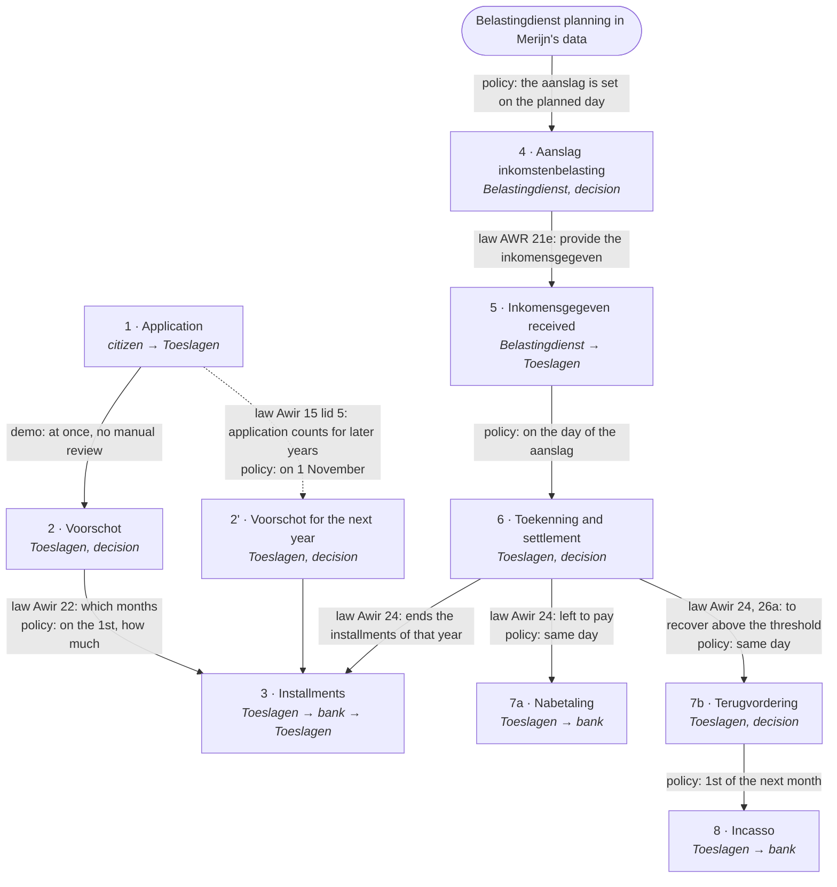
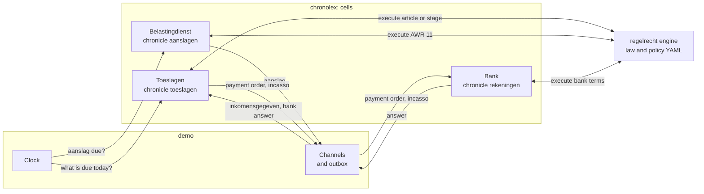
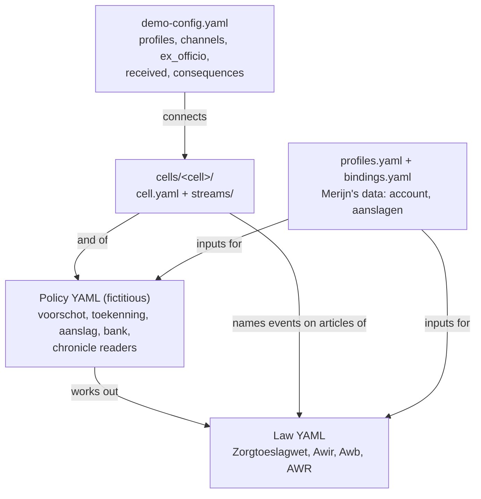
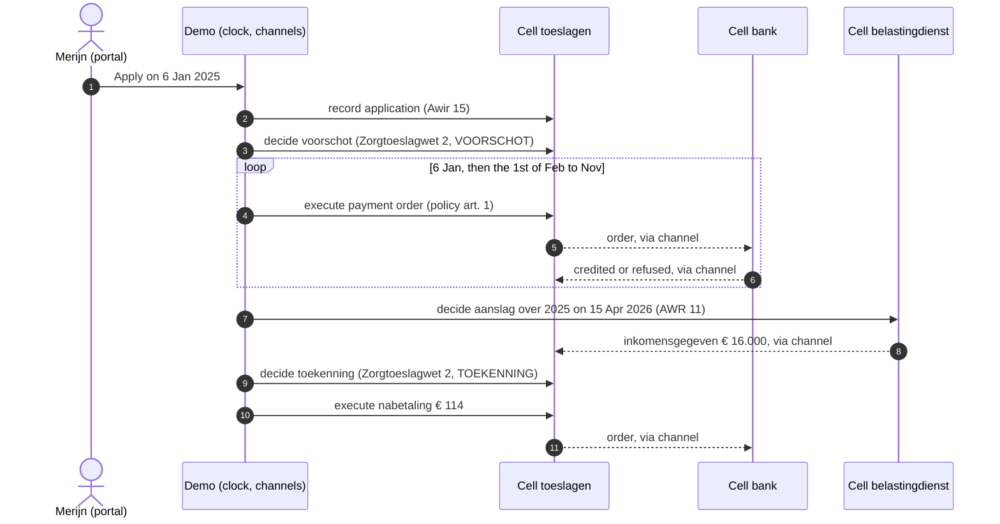

The demo follows one zorgtoeslag case from the application to the final settlement. Every legal fact on the way is recorded in a chronicle (*kroniek*), as [RFC-022](/rfcs/rfc-022) describes. This page says which law and policy carry each step, and how the recording works. The [Demo](/components/demo) page describes the screens.

## Scope and status

- **Proof of concept**, built in PR #1679 (the application), #1683 (application and decision in the demo) and #1689 (the whole process).
- **Not the law as Toeslagen executes it.** Only the articles the process needs are modeled: Awir 8, 14, 15, 16, 19, 22, 24, 26, 26a, 28 and AWR 11, 21, 21c, 21e. Zorgtoeslagwet 2 lid 5 (entitlement per month) is not modeled.
- **Some ruleworks are fictitious**: the Toeslagen policies, the inspecteur's planning and the bank. Their names start with `fictief`, and every article text says `FICTIEF`.
- **The decisions behind the design** are in RFC-045 to RFC-050.

## The process: which law, which policy

Every step of the zorgtoeslag process comes from an article of law or of policy, never from the demo or the cell. The pattern is the same at every step.

- **The law says what may or must happen, and what its content is.** Who applies (Awir 15), how high the zorgtoeslag is (Zorgtoeslagwet 2), that there is a voorschot (Awir 16), in which months it is paid (Awir 22), how the toekenning is set off against it (Awir 24), when something is recovered (Awir 26, 26a).
- **Policy says when and how, where the law leaves that open.** On which day a decision is taken, how much an installment is, which account the money goes to, how a recovery is collected. No such policy is published, so these articles are fictitious (`fictief_beleid_*`), and each says so in its text.
- **The demo only moves the clock.** On each day it asks the cells what the law and the policy make due, and carries messages between the cells.

### The steps

Edge labels say what triggers a step: **law**, **policy** (fictitious), or **demo**. Each step is recorded as one or more chronolexograms in the chronicle of the organization that takes it.



| # | Step | Law: what it says | Policy (fictitious): what it adds | When | Merijn |
|---|---|---|---|---|---|
| 1 | **Application** | [Awir 15][awir-15]: the applicant applies, for a berekeningsjaar; lid 5: the application also counts for later years. [Awb 4:2][awb-4-2]: name, address, date, signature, the decision asked for. [Awb 4:13][awb-4-13]: the decision period runs from receipt. [Awir 16][awir-16]: the expected income | [Voorschot policy art. 3][tv-3]: the account number | When the citizen submits | 6 Jan 2025, expects € 22.000 |
| 2 | **Voorschot** | [Zorgtoeslagwet 2][zts-2]: the amount, a beschikking on the application. [Awir 16][awir-16]: a voorschot on the expected income. [Awir 8][awir-8]: toetsingsinkomen. [Awir 14][awir-14]: rounding. [Awb 3:46][awb-3-46], [6:7][awb-6-7], [6:8][awb-6-8]: reasons, objection period, announcement | [Chronicle policy art. 4][kt-4]: read the expected income from the application | Demo: straight after the application (no manual review) | € 1.695 |
| 3 | **Installments** | [Awir 22][awir-22]: one installment per month, from the month of the voorschot through November (the next year: December through November) | [Voorschot policy art. 1][tv-1]: equal parts, on the 1st, to the account; [art. 2][tv-2]: paid when the bank credits it. [Bank terms art. 1][bank-1]: the bank credits unless the account is unknown or blocked | Policy: the 1st of each month | 11 × ± € 154 |
| 4 | **Aanslag** | [AWR 11][awr-11]: the inspecteur sets the aanslag, ex officio. [AWR 21c][awr-21c], [21e][awr-21e]: from it follows the inkomensgegeven, which Toeslagen receives | [Aanslag policy art. 1][as-1]: the day, from the inspecteur's planning | Policy: the planned day | 15 Apr 2026, € 16.000 over 2025 |
| 5 | **Inkomensgegeven received** | [AWR 21e][awr-21e] lid 1: the inspecteur provides it to Toeslagen | [Toekenning policy art. 1][tk-1]: Toeslagen records each inkomensgegeven it receives | When the message arrives | 15 Apr 2026 |
| 6 | **Toekenning and settlement** | [Zorgtoeslagwet 2][zts-2]: the definitive amount. [Awir 8][awir-8]: toetsingsinkomen. [Awir 19][awir-19]: the latest date of the toekenning. [Awir 24][awir-24]: set off against the voorschot; left to pay, or to recover; the payment date | [Toekenning policy art. 2][tk-2]: the toetsingsinkomen is the inkomensgegeven; [art. 3][tk-3]: decide on the day of the aanslag | Policy: the day of the aanslag | € 1.809, € 114 to pay |
| 7a | **Nabetaling** | [Awir 24][awir-24]: what is left to pay is paid out | [Toekenning policy art. 4][tk-4]: on the day of the toekenning, to the account; [art. 5][tk-5]: paid when the bank credits it | Policy: same day as the toekenning | € 114 |
| 7b | **Terugvordering** | [Awir 26][awir-26]: recovery is a beschikking. [Awir 26a][awir-26a]: nothing below the threshold. [Awir 28][awir-28]: to be paid within six weeks | [Toekenning policy art. 6][tk-6]: on the day of the toekenning, if there is something to recover | Policy: same day as the toekenning | over 2026: € 190 (15 Apr 2027) |
| 8 | **Incasso** | none: the law says only that it must be paid ([Awir 28][awir-28]) | [Toekenning policy art. 7][tk-7]: debit from the account (assumption: the citizen consented); [art. 8][tk-8]: collected when the bank debits it. [Bank terms art. 2][bank-2]: the bank debits unless the account is unknown or blocked or the balance is too low | Policy: the 1st of the month after the terugvordering | 1 May 2027 |
| 2' | **Voorschot for the next year** | [Awir 15][awir-15] lid 5: no new application needed. [Awir 16][awir-16] lid 2: before the year begins | [Voorschot policy art. 4][tv-4]: on 1 November | Policy: 1 November | 1 Nov 2025, for 2026 |

The links go to the article in the rulework on the branch of this pull request. The policies are, in full: voorschot policy `fictief_beleid_termijnbedrag_voorschot`, toekenning policy `fictief_beleid_toekenning_toeslagen`, aanslag policy `fictief_beleid_aanslagregeling`, chronicle policy `fictief_beleid_kroniek_toeslagen` and bank terms `fictieve_bankvoorwaarden`.

[awir-8]: https://github.com/NederlandseDigitaleDienst/regelrecht/blob/feature/zorgtoeslag-proces/corpus/demo/regulation/nl/algemene_wet_inkomensafhankelijke_regelingen/TOESLAGEN-2025-01-01.yaml#L79
[awir-14]: https://github.com/NederlandseDigitaleDienst/regelrecht/blob/feature/zorgtoeslag-proces/corpus/demo/regulation/nl/algemene_wet_inkomensafhankelijke_regelingen/TOESLAGEN-2025-01-01.yaml#L171
[awir-15]: https://github.com/NederlandseDigitaleDienst/regelrecht/blob/feature/zorgtoeslag-proces/corpus/demo/regulation/nl/algemene_wet_inkomensafhankelijke_regelingen/TOESLAGEN-2025-01-01.yaml#L262
[awir-16]: https://github.com/NederlandseDigitaleDienst/regelrecht/blob/feature/zorgtoeslag-proces/corpus/demo/regulation/nl/algemene_wet_inkomensafhankelijke_regelingen/TOESLAGEN-2025-01-01.yaml#L431
[awir-19]: https://github.com/NederlandseDigitaleDienst/regelrecht/blob/feature/zorgtoeslag-proces/corpus/demo/regulation/nl/algemene_wet_inkomensafhankelijke_regelingen/TOESLAGEN-2025-01-01.yaml#L679
[awir-22]: https://github.com/NederlandseDigitaleDienst/regelrecht/blob/feature/zorgtoeslag-proces/corpus/demo/regulation/nl/algemene_wet_inkomensafhankelijke_regelingen/TOESLAGEN-2025-01-01.yaml#L806
[awir-24]: https://github.com/NederlandseDigitaleDienst/regelrecht/blob/feature/zorgtoeslag-proces/corpus/demo/regulation/nl/algemene_wet_inkomensafhankelijke_regelingen/TOESLAGEN-2025-01-01.yaml#L1009
[awir-26]: https://github.com/NederlandseDigitaleDienst/regelrecht/blob/feature/zorgtoeslag-proces/corpus/demo/regulation/nl/algemene_wet_inkomensafhankelijke_regelingen/TOESLAGEN-2025-01-01.yaml#L1134
[awir-26a]: https://github.com/NederlandseDigitaleDienst/regelrecht/blob/feature/zorgtoeslag-proces/corpus/demo/regulation/nl/algemene_wet_inkomensafhankelijke_regelingen/TOESLAGEN-2025-01-01.yaml#L1223
[awir-28]: https://github.com/NederlandseDigitaleDienst/regelrecht/blob/feature/zorgtoeslag-proces/corpus/demo/regulation/nl/algemene_wet_inkomensafhankelijke_regelingen/TOESLAGEN-2025-01-01.yaml#L1323
[zts-2]: https://github.com/NederlandseDigitaleDienst/regelrecht/blob/feature/zorgtoeslag-proces/corpus/demo/regulation/nl/zorgtoeslagwet/TOESLAGEN-2025-01-01.yaml#L13
[awb-3-46]: https://github.com/NederlandseDigitaleDienst/regelrecht/blob/feature/zorgtoeslag-proces/corpus/demo/regulation/nl/algemene_wet_bestuursrecht/artikel_1_1_bestuursorgaan/AWB-1994-01-01.yaml#L420
[awb-4-2]: https://github.com/NederlandseDigitaleDienst/regelrecht/blob/feature/zorgtoeslag-proces/corpus/demo/regulation/nl/algemene_wet_bestuursrecht/artikel_1_1_bestuursorgaan/AWB-1994-01-01.yaml#L438
[awb-4-13]: https://github.com/NederlandseDigitaleDienst/regelrecht/blob/feature/zorgtoeslag-proces/corpus/demo/regulation/nl/algemene_wet_bestuursrecht/artikel_1_1_bestuursorgaan/AWB-1994-01-01.yaml#L504
[awb-6-7]: https://github.com/NederlandseDigitaleDienst/regelrecht/blob/feature/zorgtoeslag-proces/corpus/demo/regulation/nl/algemene_wet_bestuursrecht/artikel_1_1_bestuursorgaan/AWB-1994-01-01.yaml#L533
[awb-6-8]: https://github.com/NederlandseDigitaleDienst/regelrecht/blob/feature/zorgtoeslag-proces/corpus/demo/regulation/nl/algemene_wet_bestuursrecht/artikel_1_1_bestuursorgaan/AWB-1994-01-01.yaml#L552
[awr-11]: https://github.com/NederlandseDigitaleDienst/regelrecht/blob/feature/zorgtoeslag-proces/corpus/demo/regulation/nl/algemene_wet_inzake_rijksbelastingen/BELASTINGDIENST-2024-01-01.yaml#L20
[awr-21c]: https://github.com/NederlandseDigitaleDienst/regelrecht/blob/feature/zorgtoeslag-proces/corpus/demo/regulation/nl/algemene_wet_inzake_rijksbelastingen/BELASTINGDIENST-2024-01-01.yaml#L196
[awr-21e]: https://github.com/NederlandseDigitaleDienst/regelrecht/blob/feature/zorgtoeslag-proces/corpus/demo/regulation/nl/algemene_wet_inzake_rijksbelastingen/BELASTINGDIENST-2024-01-01.yaml#L226
[as-1]: https://github.com/NederlandseDigitaleDienst/regelrecht/blob/feature/zorgtoeslag-proces/corpus/demo/regulation/nl/fictief_beleid_aanslagregeling/BELASTINGDIENST-2024-01-01.yaml#L25
[kt-4]: https://github.com/NederlandseDigitaleDienst/regelrecht/blob/feature/zorgtoeslag-proces/corpus/demo/regulation/nl/fictief_beleid_kroniek_toeslagen/TOESLAGEN-2024-01-01.yaml#L385
[tv-1]: https://github.com/NederlandseDigitaleDienst/regelrecht/blob/feature/zorgtoeslag-proces/corpus/demo/regulation/nl/fictief_beleid_termijnbedrag_voorschot/TOESLAGEN-2025-01-01.yaml#L21
[tv-2]: https://github.com/NederlandseDigitaleDienst/regelrecht/blob/feature/zorgtoeslag-proces/corpus/demo/regulation/nl/fictief_beleid_termijnbedrag_voorschot/TOESLAGEN-2025-01-01.yaml#L309
[tv-3]: https://github.com/NederlandseDigitaleDienst/regelrecht/blob/feature/zorgtoeslag-proces/corpus/demo/regulation/nl/fictief_beleid_termijnbedrag_voorschot/TOESLAGEN-2025-01-01.yaml#L411
[tv-4]: https://github.com/NederlandseDigitaleDienst/regelrecht/blob/feature/zorgtoeslag-proces/corpus/demo/regulation/nl/fictief_beleid_termijnbedrag_voorschot/TOESLAGEN-2025-01-01.yaml#L444
[tk-1]: https://github.com/NederlandseDigitaleDienst/regelrecht/blob/feature/zorgtoeslag-proces/corpus/demo/regulation/nl/fictief_beleid_toekenning_toeslagen/TOESLAGEN-2025-01-01.yaml#L34
[tk-2]: https://github.com/NederlandseDigitaleDienst/regelrecht/blob/feature/zorgtoeslag-proces/corpus/demo/regulation/nl/fictief_beleid_toekenning_toeslagen/TOESLAGEN-2025-01-01.yaml#L113
[tk-3]: https://github.com/NederlandseDigitaleDienst/regelrecht/blob/feature/zorgtoeslag-proces/corpus/demo/regulation/nl/fictief_beleid_toekenning_toeslagen/TOESLAGEN-2025-01-01.yaml#L161
[tk-4]: https://github.com/NederlandseDigitaleDienst/regelrecht/blob/feature/zorgtoeslag-proces/corpus/demo/regulation/nl/fictief_beleid_toekenning_toeslagen/TOESLAGEN-2025-01-01.yaml#L205
[tk-5]: https://github.com/NederlandseDigitaleDienst/regelrecht/blob/feature/zorgtoeslag-proces/corpus/demo/regulation/nl/fictief_beleid_toekenning_toeslagen/TOESLAGEN-2025-01-01.yaml#L301
[tk-6]: https://github.com/NederlandseDigitaleDienst/regelrecht/blob/feature/zorgtoeslag-proces/corpus/demo/regulation/nl/fictief_beleid_toekenning_toeslagen/TOESLAGEN-2025-01-01.yaml#L397
[tk-7]: https://github.com/NederlandseDigitaleDienst/regelrecht/blob/feature/zorgtoeslag-proces/corpus/demo/regulation/nl/fictief_beleid_toekenning_toeslagen/TOESLAGEN-2025-01-01.yaml#L448
[tk-8]: https://github.com/NederlandseDigitaleDienst/regelrecht/blob/feature/zorgtoeslag-proces/corpus/demo/regulation/nl/fictief_beleid_toekenning_toeslagen/TOESLAGEN-2025-01-01.yaml#L550
[bank-1]: https://github.com/NederlandseDigitaleDienst/regelrecht/blob/feature/zorgtoeslag-proces/corpus/demo/regulation/nl/fictieve_bankvoorwaarden/BANK-2024-01-01.yaml#L17
[bank-2]: https://github.com/NederlandseDigitaleDienst/regelrecht/blob/feature/zorgtoeslag-proces/corpus/demo/regulation/nl/fictieve_bankvoorwaarden/BANK-2024-01-01.yaml#L125

Two kinds of policy articles appear in this table.

- **Policy that decides or acts:** `fictief_beleid_termijnbedrag_voorschot`, `fictief_beleid_toekenning_toeslagen`, `fictief_beleid_aanslagregeling`, `fictieve_bankvoorwaarden`.
- **Policy that only reads back what happened:** `fictief_beleid_kroniek_toeslagen` and `fictief_beleid_kroniek_bank`. For example: what was paid on 2025, which voorschot holds, what is still open. Those articles do not appear as a step, because they are what a step *reads*. [Lexostatuses](#lexostatuses) lists them.

[Merijn's case](#merijns-case) shows the same steps with dates and amounts.

## How it runs

Three zones work together.

- **regelrecht** executes the law. The engine knows procedures and stages (RFC-008), fires hooks (RFC-007), and runs one stage of a procedure with `execute_stage_at`. It stores nothing.
- **chronolex** is the cell. It derives the shape of each fact from the law, has the engine execute it, checks its guards, and stores the result as a chronolexogram in its chronicle. There are three cells: Toeslagen, the Belastingdienst and the bank.
- **demo** is the browser app. It holds the clock and asks the cells what is due on each day. It carries messages between the cells along the configured channels. It knows no law, event or field by name.

Everything runs in the browser as one WebAssembly module (`packages/cel` with the `wasm` feature). It exports the engine (`WasmEngine`) and the cell (`WasmCell`). Chronolexograms are kept in `localStorage`.



## What the law says, what the cell derives

A law rulework contains no chronolex words: no event names, no chronolexogram types. The cell derives the recording from ordinary law keys.

| Key in the rulework | Example | What the cell derives |
|---|---|---|
| `produces.submission: {kind: AANVRAAG}` | Awir 15 | An application chronolexogram. Its fields are the parameters the applicant fills in (origin `BELANGHEBBENDE` or `KANAAL`) |
| A hook on the submission | Awb 4:2, 4:13, Awir 16, voorschot policy art. 3 | More fields on the same application |
| `produces.moment` | Awb 4:13 lid 1 | The application counts from the moment of receipt |
| `legal_character: BESCHIKKING` with `decides_on` | Zorgtoeslagwet 2 | One decision chronolexogram per decision stage (VOORSCHOT, TOEKENNING), linked to the application |
| A parameter with origin `BELANGHEBBENDE` on the decision requested | The rent, for the huurtoeslag | A field only on an application that requests that decision (Awir 15 lid 2) |
| `legal_character: BESCHIKKING` without `decides_on` | AWR 11 | A decision ex officio, linked to nothing |
| One date in a stage's `requires` | `dagtekening_voorschot` | The cell fills in the day of the decision |
| `origin` with `rol: TIJDVAK` | `berekeningsjaar` | The year the decision is about |

How to check whether a key belongs in the law: can you explain it to a jurist without the words chronolexogram, chronicle, cell or chronolex? Then it is law. Otherwise it belongs in the cell configuration or in policy.

Recording words appear in three places, all outside the law itself.

- **The fictitious executing policies** have a `produces.extensions.chronolex` block on the articles that pay or answer. The law format has no word yet for "a payment arises here". The block names the type (`executogram`), the day (`executed_on`), when a chronolexogram arises (`record_when`), until when (`until`), what it refers to (`refers_to`), and how a repeated message is recognised (`identified_by`).
- **The Belastingdienst stream** names the year of an aanslag (`period: {parameter: belastingjaar}`). Schema v0.8.0 cannot yet say that in the law for a decision nobody applied for.
- **The chronicle policy** gives each article an `endpoint`. The cell uses it as the name of the lexostatus.

The engine sees a chronicle as an ordinary register. `fictief_beleid_kroniek_toeslagen` has an input `grams` with `source: {}`. Only `registers:` in the cell configuration says that this input is the chronicle `toeslagen`. There the register is called `dossier`, after the body's own file that the law asks for (origin `DOSSIER`), not after the policy that reads it.

## Files



All paths are under `corpus/demo/`.

| File | What it decides |
|---|---|
| `regulation/nl/…` (law) | What may and must happen, and the amounts. See [the table above](#the-steps) |
| `regulation/nl/fictie*` (policy) | When, how much per installment, which account, how to collect |
| `cells/toeslagen/cell.yaml` | The recording actor (Awir 14 lid 1), and which register is the chronicle |
| `cells/<cell>/streams/` | Per event: its name, the article it is recorded on, and which policy gives its day (`decided_on`) or its inputs (`reads`) |
| `demo-config.yaml` | What Merijn fills in, which chronolexogram goes to which cell (`channels`), for whom the Belastingdienst decides (`ex_officio`), and what the portal and the Citizen screen show |
| `profiles.yaml`, `bindings.yaml` | Merijn's bank account and opening balance, and per year the day and amount of his aanslag |

The main corpus has its own Awir and Zorgtoeslagwet. `packages/cel/tests/zorgtoeslag.rs` tests on those. `packages/cel/tests/demo_corpus.rs` runs the whole process on the demo corpus.

## Lexostatuses

A lexostatus is what a cell reads from its own chronicle to take a decision. It is not stored. The cell computes it again each time, from the chronolexograms that hold at that moment.

The law decides what a cell must deliver: the parameters that the deciding articles ask for, by name and type. The cell decides how. In order of preference ([RFC-047](/rfcs/rfc-047)):

1. **From the application.** Whatever the application already contains is read from it directly.
2. **From an article in the holder's policy.** That article reads the chronicle as a register.
3. **From cell configuration.** This is the last resort. The zorgtoeslag cell uses none.

| Lexostatus | Gives | Laid down in | Read by |
|---|---|---|---|
| `aanvraag` | every field of the application, including `bsn`, `aangevraagd_berekeningsjaar`, `datum_ontvangst` | the law: Awir 15 with its hooks | voorschot, toekenning |
| `voorschot` | `voorschotbedrag`, `dagtekening_voorschot` | chronicle policy art. 1 | payment order |
| `rekening` | `rekeningnummer` | art. 2 | payment order, nabetaling, incasso |
| `achterstand` | `achterstallig_bedrag` | art. 3 | payment order |
| `uitbetaald` | `uitbetaalde_voorschotten` | art. 3a (*aanname*: what Awir 24 lid 2 sets off) | toekenning |
| `schatting_inkomen` | `vermoedelijk_toetsingsinkomen` | art. 4 | voorschot |
| `inkomensgegeven` | `inkomensgegeven`, `datum_vaststelling_aanslag` | art. 5 | toekenning |
| `toekenning` | `nog_uit_te_betalen`, `terug_te_vorderen` | art. 6 | nabetaling, terugvordering |
| `nabetaling` | `opgedragen_nabetaling` | art. 7 | nabetaling |
| `terugvordering` | `terugvorderingsbedrag`, `dagtekening_terugvordering`, `ingevorderd_bedrag` | art. 8 | incasso |

The articles are per berekeningsjaar. The toekenning over 2025 only sets off what was paid on 2025.

Each value carries its source. The decision stores that with its chronolexogram under `inputs`, so the chronicle shows where every input came from.

**In code:** `Cell::lexostatuses` lists them, and `Cell::read_lexostatus` reads one. In the browser the calls are `cell.lexostatuses(...)` and `cell.readLexostatus(...)`. `read_lexostatus` returns the values and the chronolexograms they come from. For `aanvraag` that is the application chronolexogram. For a policy article it is every chronolexogram of the case: the engine does not report which chronolexograms the article actually used.

**In the demo:** Case system → "Lexostatuses".

[Reduction and Synthesis](/components/zorgtoeslag-reduction-and-synthesis) shows when and how each lexostatus is read, with one step worked out down to the YAML.

## Merijn's case

Merijn is the default persona. He is self-employed, single, and has two young children. He applies on 6 January 2025 and expects an income of € 22.000. The fictitious aanslagen set € 16.000 over 2025 and € 32.000 over 2026. So 2025 ends in a nabetaling and 2026 in a terugvordering.



| When | Chronolexogram | Year | Key facts |
|---|---|---|---|
| 6 Jan 2025 | `aanvraag_ontvangen` | 2025 | expected income € 22.000, account, BSN |
| 6 Jan 2025 | `voorschot_verleend` | 2025 | € 1.695 |
| 6 Jan 2025, then the 1st of Feb to Nov | `betaalopdracht_gegeven` + `voorschottermijn_betaald` (11×) | 2025 | € 154,09; the last one € 154,10 |
| 1 Nov 2025 | `voorschot_verleend` | 2026 | € 1.695 |
| the 1st of Dec 2025 to Nov 2026 | `betaalopdracht_gegeven` + `voorschottermijn_betaald` (12×) | 2026 | € 141,25 |
| 15 Apr 2026 | `inkomensgegeven_ontvangen` | 2025 | € 16.000 |
| 15 Apr 2026 | `zorgtoeslag_toegekend` | 2025 | € 1.809 − € 1.695 paid = € 114 to pay |
| 15 Apr 2026 | `nabetaling_opgedragen` + `nabetaling_betaald` | 2025 | € 114 |
| 15 Apr 2027 | `zorgtoeslag_toegekend` | 2026 | € 1.505 − € 1.695 paid = € 190 to recover (above the € 121 threshold) |
| 15 Apr 2027 | `terugvordering_vastgesteld` | 2026 | € 190, to be paid by 27 May 2027 |
| 1 May 2027 | `incasso_opgedragen` + `terugvordering_geind` | 2026 | € 190 debited |

What happens at each step:

- **Application.** The portal shows the fields the law asks for, each with the article that asks it. The cell gets them by running Awir 15 with its hooks on an empty application. The chronolexogram's `legal_basis` is Awir 15. The legal basis of each field is under `field_basis`.
- **Voorschot.** Awir 16 replaces the toetsingsinkomen with the expected income. Awir 14 rounds the result: € 1.694,88 becomes € 1.695. The cell applies the law versions in force on 1 January of the year the decision is about.
- **Installments.** Awir 22 says which months have an installment. Policy art. 1 says how much it is. A chronolexogram is only recorded when the policy says an order is given, so December 2025 has no installment for 2025. The bank credits or refuses each order. What the bank refuses is added to the next order. Only credited amounts count as paid.
- **Aanslag.** The Belastingdienst decides ex officio, only for people with an open case. `Cell::due_ex_officio` gives the next year without an aanslag and its day. For Merijn that includes 2024, which no case reads.
- **Toekenning.** It is taken on the day of the aanslag. Awir 24 sets off what was paid. Awir 19 gives the latest date. Awir 26a leaves small amounts unrecovered. After the toekenning, no installment of that year can arise anymore (`until: TOEKENNING`).
- **Terugvordering and incasso.** The terugvordering is its own decision, in the procedure `terugvordering` (Awir 26, 28). The incasso is on the 1st of the next month. The bank refuses it if the balance is too low, and then it is tried again the next month.
- **Next year.** Awir 15 lid 5 makes the application count for later years. Each decision is about one year: first the year applied for, then each year after it.

## Time

- **One clock that only moves forward.** Everything is recorded on the reference date. A chronicle refuses a chronolexogram dated before its last one. To go back, reset the demo.
- **When the clock skips days**, every skipped day is processed as of that day.
- **A future event is not a fact.** Below the facts, a case shows "What the law gives as the next moment": the cell runs the law without recording anything (`previewExecution`, `previewDecision`). "To the next moment" moves the clock to the earliest of those dates.
- **Messages.** A message that does not arrive goes to the outbox and is offered again at every clock step. Each cell records one answer per message, so a message offered twice is not recorded twice.

## Guards

| Guard | Prevents |
|---|---|
| `once_per: month` | A second payment order in the same month and year |
| `until: {stage: TOEKENNING}` | Installments after the toekenning of that year |
| `decided_on` | A decision before the day the policy gives. The exception is the first voorschot, which answers the application |
| One aanslag per year and person | A second decision ex officio over the same year |
| Required reference | An installment without a voorschot, or a bank answer without an order |
| One answer per message (`answered`) | Recording a message twice when it is offered again |
| `not_addressed` | An answer recorded by an article it is not meant for |
| Recording order | A chronolexogram dated before the chronicle's last one |
| Outbox (demo) | Losing a message that did not arrive |

## Own choices and open questions

The main choices:

- **The procedure `tegemoetkoming`** and its stages are a modeling choice. The Awir has two decisions on one application (voorschot and toekenning), but gives no list of stages.
- **Zorgtoeslagwet 2 decides.** The Awir works as the "Awb of the toeslagen": articles 16, 19, 24 and 26a hook onto that decision.
- **The expected income is a field of the application.** The law does not say how it is determined.
- **A grondslag only where an article states it literally.** Five parameters have none, and each one has a comment saying why: `bsn`, `vermoedelijk_toetsingsinkomen`, `datum_vaststelling_aanslag`, `uitbetaalde_voorschotten`, `belastingjaar`.
- **Dates and amounts in policy**: installments of equal size on the 1st of the month, the next year's voorschot on 1 November, the toekenning and terugvordering on the day of the aanslag, and the incasso on the 1st of the next month. These are all fictitious.
- **A refusal is a decision** (Awb 1:3). It is recorded, so the year counts as decided.

Open:

- The law format has no word for a payment ("an execution arises here"). The executing policies need an explicit block for it.
- Without an aanslag there is no toekenning. Awir 19 lid 2 and the inkomensgegeven without an aanslag (AWR 21 onder e, 2°) are not modeled.
- No article says which data an application must contain, such as the BSN. See [RFC-046](/rfcs/rfc-046), open question 4.
- Whether a policy article can be a grondslag. See [RFC-047](/rfcs/rfc-047), open question 4.
- Deferred on purpose: ending lid 5 (Awir 15 lid 6), entitlement per month, revising the voorschot (Awir 16 lid 5, 17) and the toekenning (20, 21, 21a), interest and collection (27–29), setting off across regulations (30), and the *zienswijze* before recovery (26b).

## Running it

```bash
just demo          # builds engine and cell to WASM, starts Vite on :7400
just demo-check    # laws, scenarios, frontend tests, WASM and build
```

1. Open the demo. Merijn is the default persona.
2. Under Demo → "Reference date", pick a day in 2025.
3. On "My government", apply for zorgtoeslag.
4. In the case system, open the case and its Chronicle.
5. Press "To the next moment" repeatedly, up to the incasso on 1 May 2027.

## Further reading

- [Demo](/components/demo): the screens
- [Reduction and Synthesis](/components/zorgtoeslag-reduction-and-synthesis): every reduction and synthesis in the demo, with one worked out in full
- [RFC-022](/rfcs/rfc-022): the cell model; RFC-045 to RFC-050: the decisions behind this page
- [RFC-008](/rfcs/rfc-008) and [Hooks and Reactive Execution](/concepts/hooks-and-reactive-execution): procedures, stages and hooks
