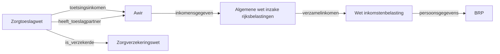

Dutch laws reference each other constantly. The Healthcare Allowance Act (*Zorgtoeslagwet*) needs your income, which is defined by the Awir. It needs your insurance status, which comes from the Zorgverzekeringswet. It needs to know whether you have an allowance partner, which the Awir determines.

Rather than duplicating these definitions, each law declares what it needs from other laws. The engine follows these references automatically.

## How it works

An article declares its inputs. When an input has a `source` block pointing to another law, the engine loads that law, executes it with the specified parameters, and feeds the result back.

```yaml
# Zorgtoeslagwet, article 2 - needs income from the Awir
input:
  - name: toetsingsinkomen
    type: amount
    source:
      regulation: algemene_wet_inkomensafhankelijke_regelingen
      output: toetsingsinkomen
      parameters:
        bsn: $bsn
```

The engine loads `algemene_wet_inkomensafhankelijke_regelingen`, executes it for the given BSN, gets the `toetsingsinkomen` output, and uses that value in the healthcare allowance calculation.

## Chains of references

References can chain. The Zorgtoeslagwet references the Awir, which might reference the Wet inkomstenbelasting, which references the BRP. The engine resolves the full chain, loading and executing each law as needed.



Results are cached: if two laws both need the same value from the BRP, it is computed once.

## A real example

The Zorgtoeslagwet article 2 declares these cross-law inputs:

```yaml
input:
  - name: is_verzekerde
    type: boolean
    source:
      regulation: zorgverzekeringswet
      output: is_verzekerd
      parameters:
        bsn: $bsn

  - name: heeft_toeslagpartner
    type: boolean
    source:
      regulation: algemene_wet_inkomensafhankelijke_regelingen
      output: heeft_toeslagpartner
      parameters:
        bsn: $bsn

  - name: toetsingsinkomen
    type: amount
    source:
      regulation: algemene_wet_inkomensafhankelijke_regelingen
      output: toetsingsinkomen
      parameters:
        bsn: $bsn
```

Each `source` block says: load this other law, pass it these parameters, and give me the named output.

## Same-law references

Articles within the same law can also reference each other. When `source` has an `output` but no `regulation`, the engine looks within the current law:

```yaml
# Zorgtoeslagwet, article 2 referencing article 4 (same law)
input:
  - name: standaardpremie
    type: amount
    source:
      output: standaardpremie
```

## Calling the decision of an article

A `regulation` reference finds the article through the output it asks for. Sometimes the article itself is what matters: the article a decision was taken under, to take that decision again. Since schema v0.8.4 a `source` can name the article with `article` ([RFC-045](/rfcs/rfc-045)).

```yaml
parameters:
  - name: besluit
    type: decision
input:
  - name: heroverweging
    type: decision
    nullable: true
    source:
      article: $besluit
```

`article` is an article reference (`wet_fictief#3`), a `$`-reference to a value that holds one, or a `$`-reference to a decision value. The engine runs the decision item of that article at stage BESLUIT. Without `output` it returns a decision value, the type `decision`:

| Field | Holds |
|---|---|
| `grondslag` | The article, as `<regulation>#<article>` |
| `fields` | The parameters it was given that it declares |
| `findings` | The findings per case it was given: for each open term it leaves to an authority per case (`decided_per_case_by`), what it established under the term's id |
| `outputs` | The outputs of its decision item, and no others |

The data the decision item lists under `derived` is computed with the decision but is not in `outputs`.

With `output` the input is that one output of the decision.

A value built from a recorded decision may also hold `taken_on`: the article that established the submission the decision was taken on. A decision given as a parameter at the top of an execution must hold it. There the engine requires exactly the five keys `{grondslag, taken_on, fields, findings, outputs}`. `grondslag` and `taken_on` must be article references (`<law>#<article>`). The engine refuses a value other than null or unknown that is no object, lacks a key, holds another or has no article reference in one of those two, and the error names the parameter and the key (RFC-045). What `fields`, `findings` and `outputs` hold is checked where the value is read. A parameter that one article passes to another may lack `taken_on`, so a value built by `source.article` can still be passed on. A `taken_on` it does hold must be an article reference.

A decision value as the target is called anew: the engine runs its `grondslag` with its own `fields` as parameters and its own `findings`. The law does not spell this out, as in the example; it is a convention of the engine.

New findings come from the caller of the engine, apart from the parameters, keyed by the id of the open term (`evaluate_law_with_findings`, and the scenario step `the following findings:`). A finding applies to every article in the execution that leaves that term to an authority per case, and wins over the decision value's own finding there. An implementation of the term still wins over both. A finding that no article in the execution asks, or that does not fit the type of its term, is an error that names it. So a misspelt finding fails instead of being dropped, and a finding for a call that does not happen fails too. The result lists under `open_terms` each open term that a finding or a regulation filled. An entry names the article that declares the term and, for a regulation, the article that implements it. That tells a consumer which of the two filled the term, even where both give the same value.

The parameters can also come from `parameters_from`, a list of objects merged in order on the fields of a decision value: a later one wins over an earlier one, and `parameters` goes on top of them all. A null object adds nothing. A name the article does not declare is dropped, and the trace says which. The exception is the id of an open term the article leaves to an authority per case (`decided_per_case_by`): that name carries the authority's finding for this case, and it is passed as a caller at the top passes it, so an implementation of the term still wins over it. Which parameters the article requires is known only when it runs, and a required parameter that is null skips the call and leaves the input null. So an input whose `parameters` hold a reference that may be null, that uses `parameters_from`, or that calls a decision value anew, is declared `nullable` (type rule N5).

A fixed reference is checked when the laws load: the article takes a decision, and an `output` is one of the decision's outputs. A reference taken from a value is known only when the article runs. The type check then knows the input is a decision value and makes no claim about `$heroverweging.outputs.x`, as for rows. At run time the engine refuses an article not in force on the date, an article without a decision, an `output` that is not one of the decision's, a value that is neither an article reference nor a decision value, and a merged value that is no object. Like any input, the call is made only when an action reads it, so an `AND` whose first condition is false does not run it.

Two decision values are compared with `EQUALS`. On lists and records it compares the numbers inside as written: `12` against `12.0` is an error, not an answer. `IN` is not strict in this way. A decision value holds its numbers as the article computed them, so a whole number the arithmetic left as `5.0` against a stored `5` is that error. A law that wants them alike says so, for example with `ROUND`.

## Circular reference detection

The engine detects circular references (law A needs law B which needs law A) and raises an error. A call to an article counts under the same keys, one per output it computes, so a cycle through `article` and `regulation` together is caught as well. The article runs once for every output of its decision, so while it runs each of those outputs counts as being resolved. A `MAX_CROSS_LAW_DEPTH` limit of 20 prevents runaway chains.

One loop is not an error: a rule that reads the value it departs from. An override reading the output it replaces, or an implementation reading the law whose open term it fills, gets that value without itself. See [Reading the value an override departs from](./hooks-and-reactive-execution#reading-the-value-an-override-departs-from).

## Further reading

- [Law Format](./law-format) - full structure of a rulework
- [Inversion of Control](./inversion-of-control) - a different pattern for cross-law values: delegation
- [Temporal Validity and Dates](./temporal-and-dates) - what happens when a reference points at a law that has ended
- [Traceability](./traceability) - a real cross-law chain shown in an execution trace
- [RFC-007: Cross-Law Execution](/rfcs/rfc-007) - the full design specification
- [Rules as Executed, section 5.1](/research/rules-as-executed#sec:depgraphs) - the position paper's dependency graph behind a single zorgtoeslag decision
