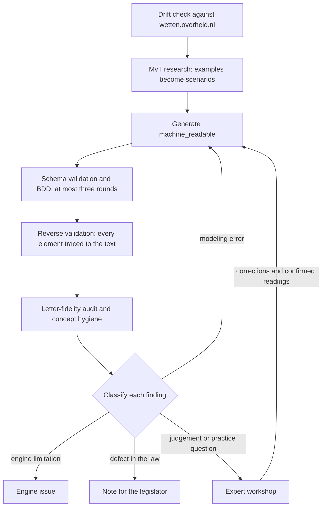
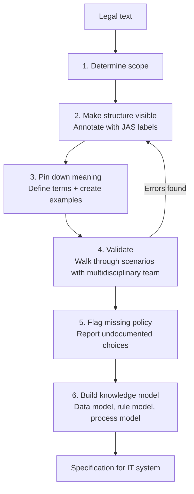
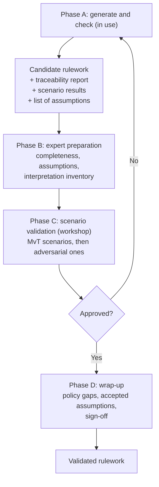

RegelRecht validates a machine-readable interpretation by running it. A model is written first, executed against scenarios, and then checked element by element against the text of the law. The desk part of this method is in daily use. The part where legal experts judge a model in a workshop is designed and has its tooling, but no validating workshop has been held yet.

The steps are carried out by skills in the repository (`.claude/skills/`). A skill is a written procedure that a person or a language model follows. The enrich worker in the [pipeline](/components/pipeline#enrich-worker) uses `law-generate` and `law-reverse-validate` when it enriches a rulework without a person at the keyboard.

## Where the method comes from

For fifteen years, teams have built methods, frameworks and languages for formalizing legal rules, mostly in isolation. The one closest to Dutch practice is Wetsanalyse, developed at implementation agencies such as the Belastingdienst, UWV and DUO. It is codified in *Wetsanalyse* (Ausems, Bulles & Lokin, 2021) and maintained by Lokin (Hooghiemstra & Partners) and Gort (ICTU).

Its core is the **Juridisch Analyseschema (JAS)**, a classification of 13 element types that labels every formulation in a legal text, from legal subject and legal relationship to derivation rule and condition. The process has six steps:

People do all of it, and the team that built the model also validates it. Traceability is built in: every element of the knowledge model (a data model in FBM or ER, rules in DMN tables, a process in BPMN) points back to the text. Other methods use other words but follow the same pattern of decomposing the text, identifying concepts, recording an interpretation, modeling, testing against cases and tracing back to the source. They are all *analysis-first*: the analysis leads to a model, and the model leads to software.

RegelRecht turns this around in two ways. The rulework is the executable interpretation itself, with no separate specification in between. And a language model writes the first draft, so the analysis runs against a candidate instead of producing one.

## What changes for the expert

| | Analysis-first | Execution-first |
|---|---|---|
| Who creates? | Human | A language model |
| Who validates? | Same team | Legal expert |
| Cognitive task | Build and check | Challenge and judge |
| Traceability | Built in at creation | Checked after the fact |
| Interpretation choices | Explicitly documented | Implicit in the draft |
| Scale | Limited by human capacity | Limited by validation capacity |

The bottleneck moves from creation to validation. The shift brings risks that analysis-first does not have. Automation bias makes a reviewer accept output as correct, and the draft anchors the reviewer's own reading. Where the law is ambiguous, the model picks a reading without saying so. Neither the model nor a reviewer who is not actively searching knows what it missed. The checks below are there to catch these.

## One law: the interpretation loop

`law-interpret` makes a single rulework executable by running three skills in order.

1. **`law-mvt-research`** searches the parliamentary papers for worked examples and writes them as Gherkin scenarios next to the rulework.
2. **`law-generate`** writes the `machine_readable` sections, validates them against the schema, and runs the scenarios. It repairs and reruns at most three times.
3. **`law-reverse-validate`** traces every input, output and operation back to the article it came from. An element with no basis in the article is removed; one the logic needs but the text does not give is reported as an assumption.

The rule that governs all three: **the model describes what the text says, not what the legislature meant.**

### The letter leads, the MvT tests

The first version of this method treated worked examples from the Memorie van Toelichting as ground truth: when the engine disagreed with an example, the rulework was wrong. Practice showed that rule to be too strong. An MvT explains the bill as introduced, and Parliament then amends it. The original memorandum of the Wet op de zorgtoeslag works out an example in which an insured person with an uninsured partner receives no allowance at all, an outcome a nota van wijziging rejected and replaced with the rule in the law today. An example is therefore a test to be checked against the enacted text. When the two disagree, the text decides, and the disagreement itself is a finding worth recording.

## Checks before an outcome is trusted

A passing scenario proves the model computes what the scenario expects. It does not prove the model follows the law. Four further skills look for the failures a green run hides.

- **`law-version-drift-check`** compares each `text:` field with the version on wetten.overheid.nl at the rulework version's `valid_from`. It runs before any edit, because a model built on a stale text is faithful to the wrong law.
- **`law-letter-fidelity-audit`** reads the model against the letter, one lid at a time. It looks for criteria taken from the toelichting rather than the text, dropped qualifiers such as a *tenzij*, and an output anchored to the wrong article.
- **`reference-and-concept-hygiene`** checks that a value bound across laws means the same thing on both sides. The same word can name two concepts in two laws (a register-based residence against a factual one), and a binding between them is wrong even when it resolves.
- **`regelrecht-scenario-traces`** asserts the intermediate steps of a chain of laws, not only the final amount, so an error in the middle cannot hide behind a correct result.

## A corpus: desk review and workshops

Across a set of related laws, `regelrecht-stelselanalyse` runs the desk cycle: harvest, model, validate with several independent reviewers, classify, fix, document. Every finding gets one of four labels, and the label decides where it goes. A modeling error is fixed in the YAML. An engine limitation becomes an engine issue. A defect in the law itself is written up for the people who maintain it. An interpretation or practice question goes to experts.

`regelrecht-dossier` is the entry point that routes between the two layers. The short form of its rule: factual defects stay at the desk, questions of judgement go to a workshop.

Two skills prepare the workshops.

- **`regelrecht-audit-products`** builds the material for a session in which legal experts validate a model: a scope analysis, a checklist per article, test scenarios and a report. A validating session is only held once the schema validates, the scenarios pass and the known modeling errors are fixed, so experts spend their time on judgement rather than on our mistakes. An exploratory session can be held earlier.
- **`regelrecht-uitvoeringstoets`** turns a validated corpus into a service prototype and uses it with people from implementation practice, to see what the law asks of a citizen and where human judgement is needed.

## The expert phases

The generate loop and the desk checks above form phase A. The expert's part is designed as three phases after it.

**Phase B, preparation.** Before any scenario runs, the expert checks whether all articles with executable logic are covered (B1), assesses each assumption reverse validation flagged (B2), and lists where the law allows more than one reading and which one the model took (B3). B1 is the scope step of Wetsanalyse asked after the fact; B3 is its meaning step asked in reverse, and it is the main defense against automation bias. The desk skills now prepare most of this material: the corpus review reports coverage, reverse validation lists the assumptions, and the letter-fidelity audit lists the places where the letter and the toelichting part ways. The judgement on each item is still the expert's.

**Phase C, scenario validation.** The expert validates the behavior of the rulework, not its YAML. The engine runs the scenarios from the parliamentary papers, and the expert checks whether the outcomes follow from the law as enacted. Then the expert writes adversarial scenarios, which is where the expert cannot be replaced: the model has no access to case law, implementation practice or political context. Edge cases from practice, "unless" paths, values just above and below a threshold, and the interaction between laws are run on the engine, and an error sends the rulework back.

**Phase D, wrap-up.** Policy gaps, where the law underspecifies and a choice was made, are written down. Assumptions are accepted or rejected, and the expert's sign-off is recorded.

Two principles shape these phases. The expert reviews reports and outcomes, never the YAML: a traceability report in readable form, scenario outcomes with references to articles, and the list of assumptions and choices. And because the expert did not build the proposal, the method makes the search for errors explicit by asking for adversarial scenarios, where Wetsanalyse validation reviews the team's own work.

| Wetsanalyse step | RegelRecht equivalent | Difference |
|---|---|---|
| 1. Determine scope | Phase A: select law; B1 | Same, checked again after the fact |
| 2. Structure annotation (JAS) | A language model writes `machine_readable` | Human to model |
| 3. Pin down meaning | B3: interpretation inventory | Proactive to reactive |
| 4. Validate with scenarios | Phase C | Own work to someone else's proposal |
| 5. Flag policy gaps | Phase D | Same |
| 6. Build knowledge model | Phase A: the rulework | Human to model |

The method keeps the discipline of Wetsanalyse (traceability, scenarios, policy gaps) and adapts it to an expert who judges rather than builds. It is itself meant to develop by Design Science Research: a hypothetical process drawn from Wetsanalyse and from research on working with generative models, put to legal experts, run in workshops on real cases, revised after each round, and published.

## Two kinds of scenario

Scenarios serve two purposes, described in [Testing](/guide/testing#two-buckets-one-language) and [Scenarios](./scenarios).

- **Law validation** (`corpus/regulation/**/scenarios/`): a failure means the law changed or the scenario is out of date, and a person decides which. CI does not block on these.
- **Engine conformance** (`bdd/conformance/`): synthetic laws that prove an engine speaks the whole language. CI blocks on these, and on the demo corpus, whose data is synthetic and whose failures are therefore always real.

## What has been done with experts

The repository records a legal expert's written corrections to three early RFCs ([RFC-002](/rfcs/rfc-002), [RFC-008](/rfcs/rfc-008), [RFC-009](/rfcs/rfc-009)), eleven in all, which now seed the curated legal memo of the enrichment design ([RFC-027](/rfcs/rfc-027)). It also records a session with OCW and DUO for which the repayment regimes in one proof of concept were worked out (`pocs/registry.yaml`). No validating workshop in the sense of `regelrecht-audit-products` has been reported, so phases B to D have not run as designed, and the Design Science Research loop has no findings to publish yet.

## Further reading

- [Ruleworks](./ruleworks): where validation sits in the life of a rulework
- [Markings](./markings): where a model records what it could not translate
- [Rules as Executed, section 5.3](/research/rules-as-executed#sec:translation): the position paper on translating law at scale, with language models doing the labor and people doing the review
