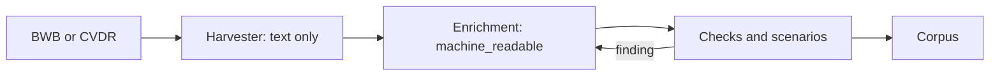

A rulework (Dutch: *regelwerk*) is one regulation as it is recorded in the law format: its legal text, article by article, with the machine-executable interpretation beside it. It is identified by its `$id`. Every other concept page describes some part of a rulework or something done with one; this page follows one from harvest to execution and links to the page that covers each step. The name and its reasons are in [RFC-044](/rfcs/rfc-044).

## What a rulework is

A rulework has **versions**. Each version is one YAML file, named after the date its text took effect, in a directory named after the `$id`. A regulation amended once is one rulework with two versions. [Law Format](/concepts/law-format) explains what a version contains.

The legal text in a rulework is a verbatim quotation. The format carries it and gives it no meaning; only the `machine_readable` sections mean something to an engine. A rulework can therefore be incomplete. The harvester writes one that holds only the text, and enrichment adds the interpretation, one article at a time.

A rulework is not the law. Where the two disagree, the published text prevails and the rulework is corrected. It is also not the schema or the format it is written in, and not the corpus that collects it. Code keeps the older word: `law_id`, the API routes and the Gherkin steps still say `law`.

## How a rulework comes into being

**Harvest.** The [harvester](/components/harvester) downloads a regulation from the national registers, BWB for national law and CVDR for decentral regulations, at the consolidation in force on a date. It splits the text into articles, leden and list items and writes a version with no `machine_readable` at all. When the register gives a final end date, the harvester sets `valid_to`. In the [pipeline](/components/pipeline#harvest-worker), the harvest worker writes the result to the corpus and queues harvests for the laws the text refers to.

**Enrichment.** The [enrich worker](/components/pipeline#enrich-worker) asks a language model to write the `machine_readable` sections, in windows of up to fifteen articles, and puts the result on a branch or in a review task for a person. Enrichment runs on request, since queueing it after every harvest is off by default, and within an hourly budget; with no budget set, the worker enriches nothing. Four RFCs shape this work, and they are built to different degrees:

| RFC | What it decides | Built |
|---|---|---|
| [RFC-033](/rfcs/rfc-033) | A window is a layer of articles none of which depends on another, from one scan of the references in the text | Yes, behind `ENRICH_WINDOW_MODE=layers`; the default still takes the next articles in order, and the scan covers references within one law |
| [RFC-027](/rfcs/rfc-027) | Requirements a legal expert can check: the source is intact, context is assembled before writing, doubt is marked, an independent reviewer looks | The deterministic checks, the source-integrity gate, context assembly and markings; not the separate reviewer and arbiter roles |
| [RFC-026](/rfcs/rfc-026) | The work is a graph of articles, prioritized by the scenarios and laws that need them, with a status per article per version | The dependency closure and single-article enrichment; not the per-article status or the prioritized queue |
| [RFC-028](/rfcs/rfc-028) | Steps and runtimes as data, with a checked-in profile and typed failures | Not built |

**Interpretation by hand.** A person, often working with a language model, can do the same with the `law-interpret` skill: research the parliamentary papers for worked examples, generate the logic, and trace every element back to the text. [Execution-First Validation](/concepts/methodology#one-law-the-interpretation-loop) describes that loop.

## How a rulework is checked

`just validate` checks every version in the corpus in two passes. The first is the JSON schema the version declares. The second is the type checker of [RFC-037](/rfcs/rfc-037), which checks operand types and the rules for absent values, and the unit check of [RFC-023](/rfcs/rfc-023); [Values](/concepts/values) explains what each refuses. The engine runs the type check again whenever it loads a rulework.

Scenarios check behavior. A [scenario](/concepts/scenarios) next to a rulework states facts and the outcome the law should give, and the engine runs it, in CI and in the editor's browser. A failing scenario there means the law changed or the scenario is stale, and a person decides which. Synthetic ruleworks in `bdd/conformance/` test the engine itself, and CI blocks on those.

[Conformance](/reference/conformance) is the question whether another engine runs the same rulework the same way. A manifest per schema version and the conformance scenarios exist; the cross-implementation suite of [RFC-014](/rfcs/rfc-014) is designed but not built.

What no check can prove is that the interpretation follows the law. The drift check, the letter-fidelity audit and the expert phases on [Execution-First Validation](/concepts/methodology) are there for that.

## Versions and validity

The engine executes a rulework for a date. It takes the newest version whose `valid_from` is on or before that date. A version with `valid_to` before the date means the regulation ended, and the engine then finds nothing; it does not fall back to an older version ([RFC-019](/rfcs/rfc-019)). [Temporal Validity and Dates](/concepts/temporal-and-dates#which-version-is-in-force) has the rules and what happens to a reference into an ended law.

Not built: a reference that names the date of the version it means ([RFC-020](/rfcs/rfc-020), draft), and harvesting the parliamentary history of each version ([RFC-030](/rfcs/rfc-030), draft).

## The corpus

The [corpus](/components/corpus) is the collection: `corpus/regulation/nl/`, with a directory per regulatory layer (`wet`, `amvb`, `ministeriele_regeling`, `gemeentelijke_verordening`, `uitvoeringsbeleid`) and synthetic ruleworks under `wet/test_*`. The demo has its own corpus in `corpus/demo/`, and cells keep their reductions in `corpus/cells/`.

A corpus can be federated: `corpus-registry.yaml` lists repositories, and the corpus library merges them at load time, so a municipality can keep its ordinances in a repository of its own ([Federated Corpus](/concepts/federated-corpus)).

## How the engine uses a rulework

The [engine](/components/engine) gets a rulework, the output asked for, a date and some facts about a person. It runs only what that output depends on, and it resolves an input when an operation first reads it ([RFC-043](/rfcs/rfc-043)). An input never read is never fetched, so the order of conditions in a law decides which registers are consulted, never what comes out. That limits the data consulted to what the outcome needs.

Many inputs come from other ruleworks. The engine follows a `source` into the other rulework and executes it ([Cross-Law References](/concepts/cross-law-references)), finds the regulation that fills an open term ([Inversion of Control](/concepts/inversion-of-control)), and fires the hooks of general laws such as the Awb ([Hooks and Reactive Execution](/concepts/hooks-and-reactive-execution)).

Every execution can return a trace that names each article applied and each value read ([Traceability](/concepts/traceability)), in a published format ([RFC-039](/rfcs/rfc-039)), and a receipt that records the versions it used ([Execution Provenance](/concepts/execution-provenance)).

## How the editor uses a rulework

The [editor](/components/frontend#editor) opens a rulework within a traject, a working branch of the corpus. Its panes show the article text, the `machine_readable` section as a form, the raw YAML, the scenarios (run in the browser, with their trace) and the notes. A note attaches to a span of legal text without changing it ([Notes and Annotations](/concepts/notes-and-annotations)).

A rulework without `machine_readable` offers to request enrichment, which turns into a review task, or to write the logic by hand. A rulework can be added by copying it from the central corpus, by harvesting it by its BWB id, or by converting an uploaded document. Every save is a commit on the traject's branch through the GitHub API; the editor does not open a pull request.

## Open points

| Point | Why open |
|---|---|
| What the rulework of a bill is called and how it is versioned before it has a date of entry into force. RFC-044 leaves this open. | Choice |
| Whether a rulework can have legal status of its own, and who would adopt it. A werkpakket on the [roadmap](/roadmap) covers it. | Research |
